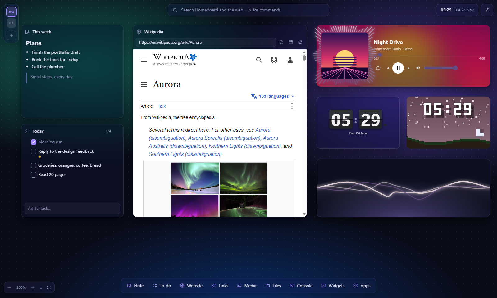
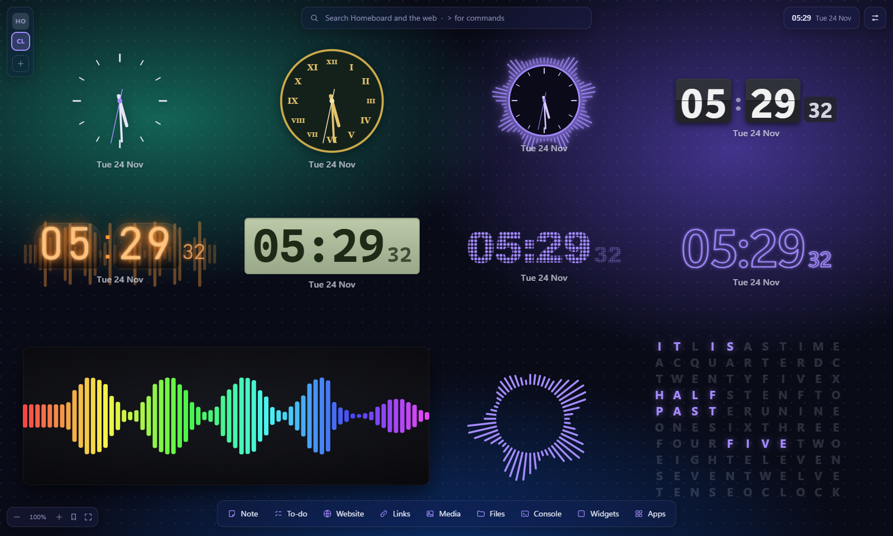

  <picture>
    <source media="(prefers-color-scheme: dark)" srcset="docs/brand/wordmark-dark.png">
    
  </picture>

**Your new tab, the way you like it.** A board for everything you keep coming back to: notes, to-do lists, links,
live websites, your music, your files, clocks and little games, arranged freely, on as many boards as you want.
Calm and plain, or loud and glowing: one dial decides.

## What it does

- **A board, not a list.** Drop notes (Markdown), to-do lists, quick links, pictures, videos and PDFs anywhere; tie
  them together with strings; zoom out to see everything, save views and jump between them with the keyboard.
- **Live windows.** Websites inside cards, signed in like your tabs, that come back where you left them. Peek at a
  link without leaving the board.
- **Your music, everywhere.** YouTube Music widgets in many looks and whole players (click-wheel, car radio,
  cassette, CD), picture frames and old TVs showing the cover, a halo that moves with the beat, visuals over the
  whole screen (bars, waves, Frost, Disco), and Now playing for everything that plays, on any board.
- **Your computer, too** (with the optional local helper): a file browser, a real terminal (Claude Code runs in it),
  app launchers and workspaces that open and arrange your windows, daily backups.
- **Find anything.** The search box finds boards, cards and the words inside notes as you type; `>` lists commands.
- **Many boards, one place.** Boards inside boards, linked notes that stay the same in several places, links to any
  board, view or card.

## Make it yours

- **Style kits** set colours, material (solid, frosted, liquid glass, paper, neon), backdrop and font together;
  **Shuffle** invents a new one that still goes together. Colours can follow the album cover of what plays, and
  fade gently from song to song.
- **See before you pick**: clock faces, players, frames, visualisers and backgrounds open as galleries of live previews.
- **Intensity**, from Calm to Wild: how much everything moves, glows and shines.
- **Your own CSS** for the whole board or for a single card. See [docs/STYLING.md](docs/STYLING.md).
- **Custom components**: cards you design in HTML, CSS and JavaScript, safely sandboxed, written in the built-in
  editor or as files that reload as you save. See [docs/COMPONENTS.md](docs/COMPONENTS.md).
- **Design with AI**: describe what you want; Homeboard writes a complete brief for Claude Code or any assistant,
  which builds the component or the look for you. Homeboard itself has no AI inside and sends nothing anywhere.

## Install (two minutes)

1. Download or clone this repository.
2. Open `edge://extensions` (Microsoft Edge) or `chrome://extensions` (Chrome), switch on **Developer mode**, click
   **Load unpacked** and choose the folder.
3. Open a new tab and choose **Keep changes** when the browser asks.

Optional, on Windows: the **helper** (files, console, apps, backups) starts with `tools\start-helper.ps1`
(right-click → Run with PowerShell). Updating, the helper, Firefox and more: [docs/GUIDE.md](docs/GUIDE.md).

## Privacy

No servers, no accounts, no analytics, no tracking. Your boards stay on your computer. Why each permission is
needed: [docs/PRIVACY.md](docs/PRIVACY.md).

## Documentation

| | |
|---|---|
| [Guide](docs/GUIDE.md) | everything Homeboard does, and how |
| [Styling](docs/STYLING.md) | your own CSS: the parts and the colours |
| [Components](docs/COMPONENTS.md) | custom components and the `homeboard` API |
| [Architecture](docs/ARCHITECTURE.md) | how the code fits together |
| [Performance](docs/PERFORMANCE.md) | what it costs your computer, and what was done about it |
| [Changelog](CHANGELOG.md) | what changed |
| [Contributing](CONTRIBUTING.md) | running it from source, the tests, the style |

## Development

Plain HTML, CSS and JavaScript, no build step: the folder is the extension. The logo and brand files are in
[docs/brand](docs/brand/BRAND.md) (`social-preview.png` is the repository's social preview: GitHub → Settings → Social preview). 25 test suites drive a headless Edge, and `dev/perftest.js` measures a busy board
(`node dev/exttest.js <this folder> <new empty folder>`); see [CONTRIBUTING.md](CONTRIBUTING.md).

## Licence

[MIT](LICENSE). xterm.js (in `vendor/xterm`) is MIT-licensed by its authors.
